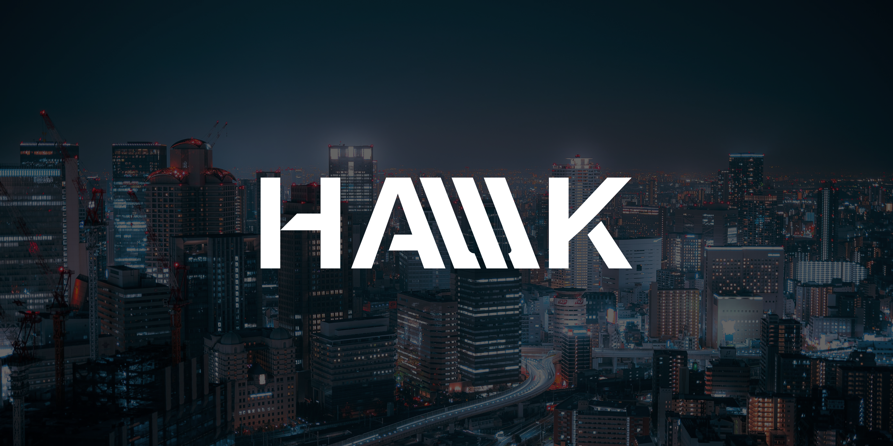

<div align="center">

  

  <p align="center">
    <!-- Links rápidos de navegação / ação -->
    <a href="https://youtu.be/V-KrAMAVZYk" target="_blank">
      
    </a>
    <a href="https://github.com/HAWK-GS02/HAWK-cross" target="_blank">
      
    </a>
    <a href="https://hawk-platform.vercel.app" target="_blank">
      
    </a>
  </p>

  <p align="center">
    <!-- Tecnologias -->
    
    
    
    
    
    
  </p>

  <sub><b>FIAP · Global Solution 2026.2</b> · CitizenTech · Engenharia de Software</sub>

</div>

---

## 🚦 O Desafio

As cidades contemporâneas enfrentam múltiplos desafios de mobilidade e inclusão. Um dos mais críticos ocorre diariamente no chão das ruas: **o tempo das travessias de pedestres**.

Semáforos com temporizadores fixos e inflexíveis ignoram a diversidade humana e as diferentes velocidades de marcha. Para muitos cidadãos, a contagem regressiva convencional representa insegurança e risco constante de acidentes.

> [!INFO]
> **Populações mais vulneráveis a ciclos semafóricos estáticos:**
> - Pessoas idosas;
> - Pessoas com deficiência ou mobilidade reduzida permanente ou temporária;
> - Usuários de cadeiras de rodas, muletas, andadores e bengalas;
> - Gestantes e pessoas com carrinhos de bebê;
> - Indivíduos com passadas mais curtas ou com diferentes ritmos de deslocamento.

> *"Por que as pessoas precisam se adaptar ao tempo rígido da infraestrutura, quando a própria infraestrutura tem a capacidade de se adaptar às pessoas?"*

---

## 💡 A Solução HAWK

O **HAWK** transforma a infraestrutura viária em um agente ativo de proteção e cidadania. Em vez de impor intervalos rígidos, a tecnologia monitora em tempo real a ocupação da faixa de pedestres e **prolonga dinamicamente o tempo de proteção** enquanto houver alguém atravessando com segurança.

```
       [ Pedestre na Faixa ] ──▶ [ Sensor / Monitoramento ]
                                          │
                                          ▼
[ Semáforo Aberto / Protegido ] ◀── [ HAWK Cross (Ciclo Adaptativo) ]
               │
               ▼
   [ Registro em Tempo Real ] ──▶ [ HAWK Control (Central Web) ]
```

> [!NOTE]
> **Privacidade por Design:** O sistema não utiliza reconhecimento facial, nem armazena biometria ou dados que identifiquem os pedestres. Apenas a presença e a dinâmica de ocupação da área da faixa são avaliadas.

---

## 📦 Ecossistema do Projeto

O ecossistema é formado por dois pilares integrados: hardware de controle e software de gestão.

### 🔌 HAWK Cross
> **Sistema de Travessia Adaptativa (Hardware / Firmware)**  
> 🔗 [Acessar repositório do HAWK Cross](https://github.com/HAWK-GS02/HAWK-cross)

Responsável pela sensoriabilização direta na via, lógica de controle de tráfego e acionamento dos ciclos semafóricos.

- [x] **Simulação de Detecção de Ocupação:** Monitoramento contínuo da presença de pedestres na faixa.
- [x] **Ciclos com Tempo de Proteção Mínimo:** Garantia de intervalo base obrigatório.
- [x] **Extensão Dinâmica Controlada:** Prolongamento do sinal verde para pedestres até um limite seguro.
- [x] **Tratamento de Falhas e Ruídos:** Descarte de leituras falsas e contingência operacional.
- [x] **Telemetria Local:** Emissão de logs de eventos para a central.

---

### 🖥️ HAWK Control
> **Central Web de Gestão & Monitoramento**  
> 🔗 [Acessar aplicação em tempo real](https://hawk-platform.vercel.app)

Interface operacional para órgãos de trânsito, gestores públicos e equipes de manutenção urbana.

- [x] **Histórico de Eventos:** Registro cronológico de acionamentos, extensões e transições de ciclo.
- [x] **Métricas & Indicadores:** Tempo médio de travessia, volume de extensões demandadas e eficiência viária.
- [x] **Gestão de Incidentes:** Alertas imediatos para anomalias, falhas de sensores ou desconexões.

---

## ⚙️ Como Funciona

O fluxo operacional do HAWK opera de forma autônoma e contínua em três etapas:

| Etapa | Ação | Descrição |
| :---: | :--- | :--- |
| **01** | **Monitoramento da Faixa** | O módulo sensorial do HAWK Cross analisa a ocupação da faixa de pedestres durante a janela de travessia. |
| **02** | **Controle & Decisão Adaptativa** | O microcontrolador processa a leitura. Se a faixa continuar ocupada próximo ao encerramento do ciclo base, o tempo é estendido com segurança. |
| **03** | **Telemetria & Gestão Centralizada** | Todos os eventos (tempo base, extensões concedidas e logs de integridade) são enviados à nuvem e exibidos no HAWK Control. |

---

## 🎯 Princípios Fundamentais

| Pilar | Como aplicamos |
| :--- | :--- |
| ♿ **Acessibilidade** | Elimina a pressão do relógio fixo para quem caminha em ritmos diferenciados. |
| 🤝 **Inclusão** | Promove equidade no espaço público sem exigir ações extras do pedestre (como botões inacessíveis). |
| 🔒 **Privacidade** | Foco exclusivo na ocupação da faixa — zero reconhecimento facial ou coleta de dados biométricos. |
| ⚡ **Adaptabilidade** | O tempo de ciclo responde aos dados reais da via em cada instante. |
| 🛡️ **Confiabilidade & Segurança** | Limite máximo de extensão com redundância para garantir a fluidez geral do tráfego. |
| 📊 **Transparência** | Auditoria total de eventos e dados abertos para o aprimoramento contínuo das vias. |

---

## 🔬 Escopo do MVP

Desenvolvido como Prova de Conceito (PoC) acadêmica em ambiente controlado:

| Componente | Escopo no MVP |
| :--- | :--- |
| **Simulação de Sensoriamento** | Implementação de modelo simulado para detecção de presença de pedestres na faixa. |
| **Unidade de Controle** | Microcontrolador (ESP32) processando as regras de transição de estados e temporização. |
| **Sensoriamento** | Detecção de presença com tratamento de filtros contra oscilações espúrias. |
| **Tratamento de Exceções** | Fallback seguro para o ciclo padrão caso haja falha ou inconsistência sensorial. |
| **Back-end & API** | Serviço em FastAPI para recepção de telemetria e persistência de dados. |
| **Front-end Web** | Painel analítico e operacional construído em React + TailwindCSS. |

---

## 🌐 Objetivos de Desenvolvimento Sustentável (ODS)

O HAWK foi concebido alinhado com as metas da **Agenda 2030 da ONU**:

|  |  |
| --- | --- |
| <i>Meta 11.2:</i> Proporcionar o acesso a sistemas de transporte seguros, acessíveis e sustentáveis para todos, melhorando a segurança rodoviária e dando atenção especial às necessidades das pessoas em situação de vulnerabilidade, mulheres, crianças, pessoas com deficiência e idosos. | Meta 10.2:</i> Empoderar e promover a inclusão social, econômica e política de todos, independentemente da idade, sexo, deficiência, raça, etnia, origem ou condição econômica, eliminando barreiras físicas na cidade. |


---

## ⚠️ Limitações e Considerações

> [!IMPORTANT]
> Este projeto possui caráter estritamente acadêmico e experimental (Proof of Concept):
> - **Simulação de Cenários:** O HAWK foi testado em ambiente controlado e simulado, não em vias públicas.
> - **Não é um produto comercial:** O HAWK não foi testado em vias públicas e não deve ser utilizado em ambientes reais sem validação técnica e legal.

---

## 👥 Equipe

<div align="center">

| Foto | Integrante | RM | GitHub |
| :---: | :--- | :---: | :---: |
|  | **Esther dos Santos de Almeida Tozzo** | `570860` | [@esthertozzo](https://github.com/esthertozzo) |
|  | **Felipe de Oliveira Zimmermann** | `570863` | [@FelZimmer](https://github.com/FelZimmer) |
|  | **Izabela Pordeus de Almeida** | `570316` | [@ibpds](https://github.com/ibpds) |
|  | **João Victor Santos Souza** | `569949` | [@ojoaox](https://github.com/ojoaox) |
|  | **Matheus Lopes Lima** | `571458` | [@Ntslopes](https://github.com/Ntslopes) |

<br />

**HAWK — Tecnologia para cidades mais humanas.**  
<sub>FIAP · Global Solution 2026.2 · CitizenTech</sub>

</div>
